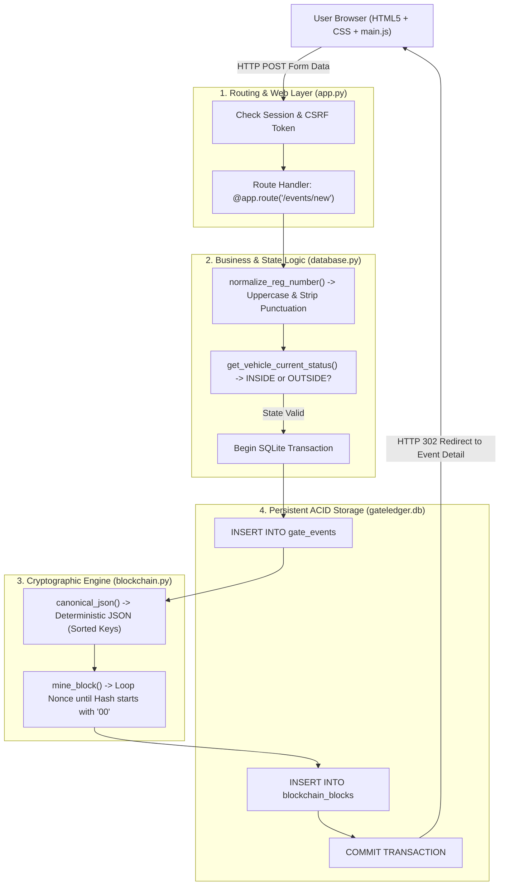
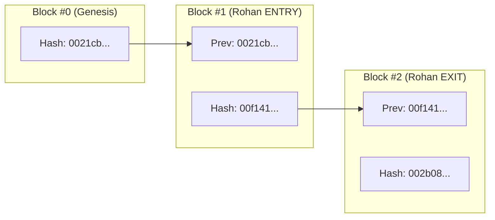
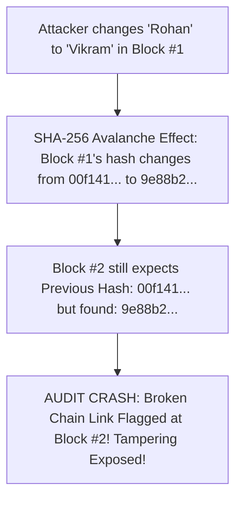
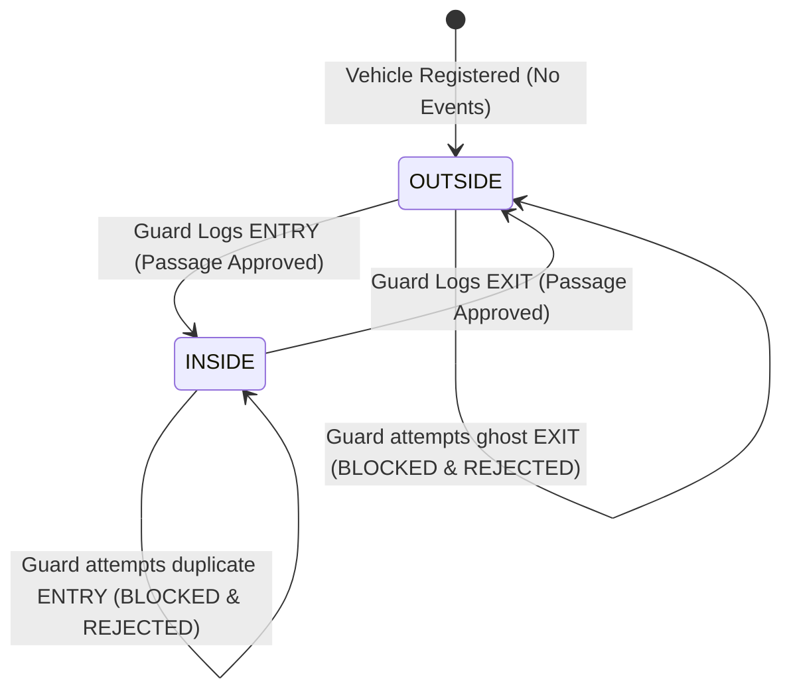

# GateLedger: The Complete Project Path & Architecture Guide

> **A Complete, Human-Friendly Walkthrough of the GateLedger Blockchain Campus Bike Log**  
> *Designed for College Students, Evaluators, Teachers, and Developers.*

---

## 🧭 Table of Contents
1. [The Big Idea: Why Does This Project Exist?](#1-the-big-idea-why-does-this-project-exist)
2. [The Real-World Path: A Day in the Life of a Bike on Campus](#2-the-real-world-path-a-day-in-the-life-of-a-bike-on-campus)
3. [The Technical Path: How Data Travels Through the Code](#3-the-technical-path-how-data-travels-through-the-code)
4. [The Cryptographic Path: How Blocks are Born and Linked](#4-the-cryptographic-path-how-blocks-are-born-and-linked)
5. [The Tamper-Proof Path: Why Nobody Can Cheat the System](#5-the-tamper-proof-path-why-nobody-can-cheat-the-system)
6. [Complete System Blueprint & Architecture Diagrams](#6-complete-system-blueprint--architecture-diagrams)
7. [Comprehensive Reference Tables](#7-comprehensive-reference-tables)
   - [File & Module Directory](#table-1-project-files-and-their-exact-roles)
   - [Database Tables & Fields](#table-2-database-schema-explanation)
   - [All Routes & Permissions](#table-3-application-routes-and-endpoints)
   - [User Roles & Permissions](#table-4-role-based-access-matrix)
8. [Viva Master Cheat-Sheet](#8-viva-master-cheat-sheet)

---

## 1. The Big Idea: Why Does This Project Exist?

Imagine your college campus gate has 2,000 students and staff entering every morning on motorcycles and scooters.

### The Old Way (And Why It Fails)
| Traditional Method | How It Works | How People Cheat or Fail |
| :--- | :--- | :--- |
| **Paper Register** | Guard writes plate number, time, and signature in a big notebook. | • Pages can be torn out.<br>• Ink fades or gets soaked in rain.<br>• Guards can forge entries after an incident.<br>• Finding a bike from 2 weeks ago takes hours. |
| **Normal SQL Database** | Guard types into a standard web page connected to an SQL table. | • Anyone with database access (or a rogue admin) can run: `UPDATE gate_events SET rider_name = 'Friend' WHERE id = 10;`<br>• The edit leaves **zero mathematical trace**. |

### The GateLedger Way
GateLedger combines the convenience of a modern digital gate log with the **tamper-evident mathematical security of a blockchain**:
1. When a bike enters or exits, the event is saved.
2. **Instantly and automatically**, a digital "wax seal" (a **block**) is computed using **SHA-256 cryptography**.
3. Every new block is permanently glued to the hash of the block before it.
4. **If anyone touches an old record**, the seal shatters, the chain link snaps, and the system immediately rings the alarm!

---

## 2. The Real-World Path: A Day in the Life of a Bike on Campus

To understand the project, follow this real-world story of a student named **Rohan Sharma** and his motorcycle (`PB10AB1234`).

```mermaid
journey
    title A Day in the Life of Rohan's Bike (The Passage Lifecycle)
    section Morning Arrival (08:30 AM)
      Rohan arrives at Main Gate: 5: Rohan
      Guard enters plate PB10AB1234: 5: Guard
      System confirms status is OUTSIDE: 5: GateLedger
      Guard logs ENTRY: 5: Guard
      Block #1 is mined and sealed: 5: GateLedger
    section Fraud Attempt (11:00 AM)
      A friend tries to log ENTRY for PB10AB1234: 1: Attacker
      System flags: Already INSIDE campus: 1: GateLedger
      Entry is REJECTED (Zero corrupt blocks created): 5: GateLedger
    section Evening Exit (05:00 PM)
      Rohan leaves via Main Gate: 5: Rohan
      System confirms status is INSIDE: 5: GateLedger
      Guard logs EXIT: 5: Guard
      Block #2 is mined linking to Block #1: 5: GateLedger
    section Audit Time (Next Day)
      College Admin verifies Blockchain: 5: Admin
      All 256-bit hashes verified intact: 5: GateLedger
```

### Step 1: Morning Entry (08:30 AM)
1. Rohan drives his Honda Activa up to the Main Gate.
2. The security guard types `PB10AB1234` into the form at `/events/new`.
3. In under 0.1 seconds, the frontend automatically contacts `/api/vehicle/lookup?reg=PB10AB1234`:
   - It fetches Rohan's name, department (`Student`), and Roll ID (`CS2023-441`).
   - It checks his current status: **OUTSIDE**.
4. The guard clicks **"Log Vehicle ENTRY & Append Block"**.
5. The system performs an **atomic transaction**:
   - Saves the entry event snapshot to the `gate_events` table.
   - Mines **Block #1** using Proof of Work (finding a hash starting with `00`).
   - Glues Block #1 to **Block #0 (Genesis)**.
6. The dashboard count for **"Bikes Inside Campus"** increments from `0` to `1`.

### Step 2: The Blocked Fraud Attempt (11:00 AM)
1. Another student arrives at the North Gate and claims they are riding `PB10AB1234`.
2. The guard selects **ENTRY** and types `PB10AB1234`.
3. The system checks the latest event for that vehicle:
   - *Latest event was ENTRY at 08:30 AM $\to$ Status is currently **INSIDE**.*
4. The system **refuses the submission** and displays a bold red alert:
   > *"Vehicle 'PB10AB1234' is already INSIDE campus. An EXIT event must be recorded before another entry."*
5. **Security Result:** No phantom record is logged, and no invalid blockchain block is mined.

### Step 3: Evening Exit (05:00 PM)
1. Rohan finishes his lab classes and rides to the Main Gate to go home.
2. The guard types `PB10AB1234` and selects **EXIT**.
3. The system checks: *Current status is INSIDE $\to$ Valid transition!*
4. The system records the exit event and mines **Block #2**:
   - Block #2 stores Block #1's hash in its `previous_hash` field.
5. The dashboard count for **"Bikes Inside Campus"** drops back down by 1.

---

## 3. The Technical Path: How Data Travels Through the Code

When a user clicks a button in the browser, data flows through five distinct software layers:



---

## 4. The Cryptographic Path: How Blocks are Born and Linked

Many people find blockchain confusing until they see the actual math. Here is the exact calculation GateLedger performs.

### The Mathematical Formula
Every block calculates its identity using **NIST-standard SHA-256**:

$$\text{Block Hash} = \text{SHA-256}\Big(\text{Index} \parallel \text{Timestamp} \parallel \text{Event ID} \parallel \text{Canonical Data JSON} \parallel \text{Previous Hash} \parallel \text{Nonce}\Big)$$

### Concrete Example:
Let's see what was fed into the computer to generate **Block #1**:

```text
block_index    = 1
timestamp_utc  = 2026-10-25T08:42:12.123456+00:00
event_id       = 1
data_json      = {"campus_id":"CS2023-441","event_timestamp_utc":"...","event_type":"ENTRY","gate_name":"Main Gate","operator_id":2,"owner_type":"Student","registration_number":"PB10AB1234","rider_name":"Rohan Sharma"}
previous_hash  = 0021cb4a81... (The hash of Genesis Block #0)
nonce          = 17
```

### What is the "Nonce" and "Proof of Work"?
- If we hash the string with `nonce = 0`, the hash might be: `a4f891...` (Does not start with `00` $\to$ **Rejected**)
- With `nonce = 1`, the hash might be: `7bc102...` (Does not start with `00` $\to$ **Rejected**)
- ... The computer tries over and over ...
- At `nonce = 17`, the hash is: `00f14116b4e8c1d...` (**Starts with `00` $\to$ ACCEPTED!**)

Because the hash starts with `00`, **Proof of Work is satisfied**, and the block is declared officially mined and valid!

---

## 5. The Tamper-Proof Path: Why Nobody Can Cheat the System

Why is this called a **chain**? Because every block holds the cryptographic fingerprint of the block before it:



### What happens if an Attacker tries to cheat?
Imagine a rogue employee opens the database file directly and alters Block #1 to claim that the rider was *"Vikram"* instead of *"Rohan"*:



Even changing a single comma or letter alters the entire 64-character hash. The chain link snaps immediately!

---

## 6. Complete System Blueprint & Architecture Diagrams

### A. Finite State Machine (Vehicle State Rules)



---

## 7. Comprehensive Reference Tables

### Table 1: Project Files and Their Exact Roles

| File Path | Component | What It Does |
| :--- | :--- | :--- |
| [`app.py`](file:///c:/blockchain_project/gateledger-campus-bike-log/app.py) | **Flask Application** | Handles all HTTP routes, web pages, CSRF verification, template filters, and API endpoints. |
| [`blockchain.py`](file:///c:/blockchain_project/gateledger-campus-bike-log/blockchain.py) | **Blockchain Engine** | Implements SHA-256 hashing, Proof-of-Work mining (`mine_block`), chain verification, and the safe tamper simulation. |
| [`database.py`](file:///c:/blockchain_project/gateledger-campus-bike-log/database.py) | **Database & State Layer** | SQLite schema setup, registration normalization, atomic transaction handling, and derived status calculations. |
| [`auth.py`](file:///c:/blockchain_project/gateledger-campus-bike-log/auth.py) | **Authentication & Security** | Werkzeug PBKDF2 password hashing, login/logout sessions, `@login_required`, `@admin_required`, and CSRF protection. |
| [`config.py`](file:///c:/blockchain_project/gateledger-campus-bike-log/config.py) | **Configuration** | Environment variables, local timezone (`Asia/Kolkata`), difficulty setting (`2`), and cloud adapter. |
| [`seed.py`](file:///c:/blockchain_project/gateledger-campus-bike-log/seed.py) | **Data Seeder** | Seeds 5 realistic student/staff/visitor bikes and 6 mined blockchain blocks for immediate demonstration. |
| [`static/css/style.css`](file:///c:/blockchain_project/gateledger-campus-bike-log/static/css/style.css) | **Stylesheet** | High-contrast, custom campus-security theme (Navy & Teal). Pure CSS with zero external CDN dependencies. |
| [`static/js/main.js`](file:///c:/blockchain_project/gateledger-campus-bike-log/static/js/main.js) | **Client Scripts** | Debounced vehicle lookup autofill, live status banner updates, and JSON block inspection modal. |
| [`templates/`](file:///c:/blockchain_project/gateledger-campus-bike-log/templates/) | **HTML Templates** | 14 custom Jinja2 HTML templates covering Dashboard, Passage Form, Records, Blockchain Explorer, and Errors. |
| [`tests/`](file:///c:/blockchain_project/gateledger-campus-bike-log/tests/) | **Automated Tests** | 25 automated pytest tests verifying blockchain math, gate state transitions, authentication, and CSV exports. |
| [`vercel.json`](file:///c:/blockchain_project/gateledger-campus-bike-log/vercel.json) | **Cloud Deployment** | Vercel serverless routing configuration for one-click online deployment. |

---

### Table 2: Database Schema Explanation

| Table Name | Purpose | Key Columns | Integrity Rules |
| :--- | :--- | :--- | :--- |
| **`users`** | Stores campus operators. | `id`, `username`, `password_hash`, `role` (`admin`/`guard`), `is_active` | Passwords hashed with PBKDF2/SHA-256. Cannot deactivate last active admin. |
| **`vehicles`** | Master vehicle catalog. | `id`, `registration_number` (Unique), `display_registration`, `owner_name`, `owner_type` | License plates are normalized to uppercase alphanumeric (no dashes/spaces). |
| **`gate_events`** | Historical passage records. | `id`, `vehicle_id`, `event_type` (`ENTRY`/`EXIT`), `event_timestamp_utc`, `rider_name_snapshot` | **Immutable Snapshots**: Preserves rider details at time of entry even if profile changes later. |
| **`blockchain_blocks`** | The immutable ledger. | `id`, `block_index` (Unique), `timestamp_utc`, `event_id`, `data_json`, `previous_hash`, `nonce`, `block_hash` | Block 0 is Genesis. Every block points to previous block's hash. |

---

### Table 3: Application Routes and Endpoints

| URL Path | Method | Access Level | Description |
| :--- | :---: | :---: | :--- |
| `/login` | `GET` / `POST` | Public | Login screen with quick-fill demo buttons for Admin and Guard. |
| `/logout` | `POST` | Logged In | Clears session securely and redirects to login. |
| `/` | `GET` | Logged In | **Dashboard**: Live derived stats (bikes inside, entries today, ledger status). |
| `/events/new` | `GET` / `POST` | Logged In | **Log Passage**: Dedicated form with instant vehicle lookup and atomic block mining. |
| `/api/vehicle/lookup` | `GET` | Logged In | Internal AJAX JSON API to retrieve vehicle status and autofill fields. |
| `/events` | `GET` | Logged In | **Gate Records**: Filterable by plate, rider, date range, and entry/exit type. |
| `/events/<id>` | `GET` | Logged In | **Event Audit View**: Side-by-side display of real-world event and its blockchain proof. |
| `/events/export/csv` | `GET` | Logged In | Generates downloadable CSV report with timestamps and block hashes. |
| `/vehicles` | `GET` | Logged In | Vehicle catalog with active inside/outside badges. |
| `/vehicles/new` | `GET` / `POST` | Logged In | Register a new campus vehicle. |
| `/vehicles/<id>` | `GET` | Logged In | Vehicle profile and complete chronological passage history timeline. |
| `/blockchain` | `GET` | Logged In | **Blockchain Explorer**: Live block ledger table, hash inspector, and tamper demo. |
| `/blockchain/verify` | `POST` | Logged In | Audits all blocks from Genesis to Head; verifies PoW and link continuity. |
| `/blockchain/simulate-tamper` | `POST` | Logged In | Modifies an in-memory block copy to safely prove tamper detection during viva. |
| `/admin/users` | `GET` | Admin Only | User management: create guard/admin accounts, toggle active status. |

---

### Table 4: Role-Based Access Matrix

| Feature / Page | Security Guard (`guard`) | System Administrator (`admin`) |
| :--- | :---: | :---: |
| Access Dashboard & Live Counts | ✅ Yes | ✅ Yes |
| Record Vehicle ENTRY and EXIT | ✅ Yes | ✅ Yes |
| Real-time Vehicle Lookup & Autofill | ✅ Yes | ✅ Yes |
| View & Filter Gate Records | ✅ Yes | ✅ Yes |
| View Blockchain Explorer & Blocks | ✅ Yes | ✅ Yes |
| Trigger Blockchain Integrity Audit | ✅ Yes | ✅ Yes |
| Run Safe Tamper Simulation | ✅ Yes | ✅ Yes |
| Export Filtered CSV Reports | ✅ Yes | ✅ Yes |
| Manage User Accounts (`/admin/users`) | ❌ **Blocked (HTTP 403 / Redirect)** | ✅ Yes |
| Create New Guards / Admins | ❌ **Blocked** | ✅ Yes |
| Deactivate Operator Accounts | ❌ **Blocked** | ✅ Yes |

---

## 8. Viva Master Cheat-Sheet

Keep these concise, punchy answers ready for your evaluation:

1. **Why use blockchain for campus bikes?**
   > *"In an ordinary database, someone can delete or edit an entry silently. With blockchain, each record is cryptographically sealed into a SHA-256 block linked to the previous block. Any change breaks the chain, making tampering mathematically impossible to hide."*

2. **What does Proof of Work do in this project?**
   > *"Proof of Work requires the computer to find a 'nonce' number that makes the block's SHA-256 hash begin with '00'. It demonstrates computational commitment and rate-limiting."*

3. **What is the difference between this and Bitcoin?**
   > *"Bitcoin is a decentralized, public, peer-to-peer network with cryptocurrency. GateLedger is a private, educational, single-node permissioned blockchain designed specifically for campus physical access auditing."*

4. **What is an atomic transaction?**
   > *"It means the gate event and the blockchain block are saved together as one single package. If mining fails, the gate event is rolled back so the database is never left with an unsealed or corrupt record."*
