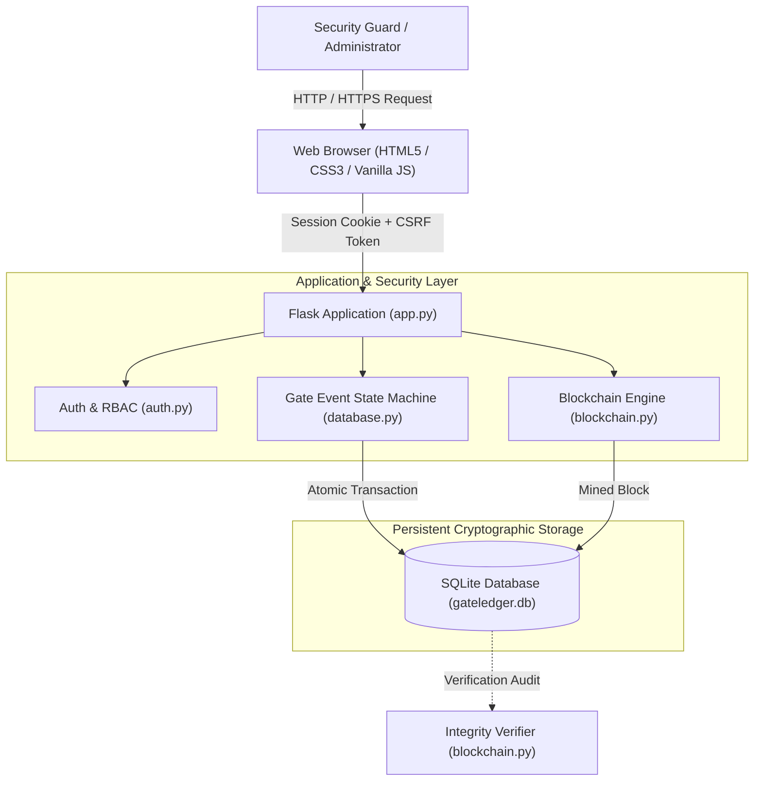
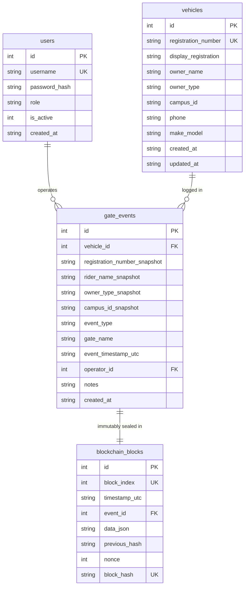
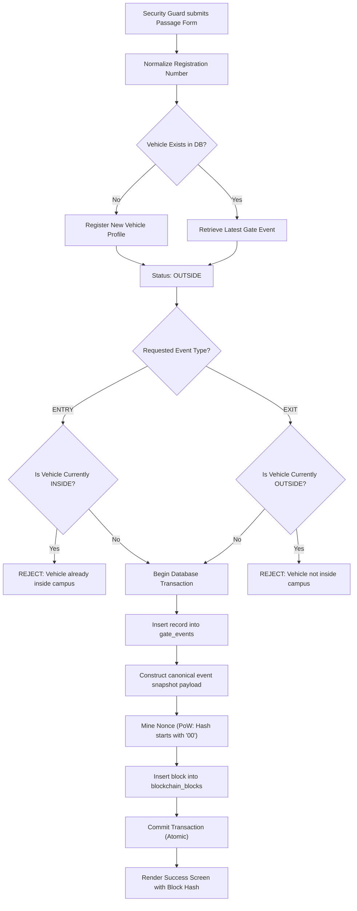

# GateLedger: Campus Bike Entry & Exit Log Using Blockchain
## Technical Project Report & System Documentation

**Degree:** Bachelor of Technology (B.Tech) in Computer Science and Engineering  
**Academic Year:** 2025–2026  
**System Name:** GateLedger  
**Architecture:** Python / Flask / SQLite3 / Persistent SHA-256 Proof-of-Work Blockchain  

---

## Abstract

Campus security departments routinely manage thousands of two-wheeler vehicle movements through college access gates each day. Conventional mechanisms for monitoring vehicle passage—predominantly manual paper logbooks or ordinary relational database tables—are susceptible to unauthorized tampering, page removal, retrospective record manipulation, and human logging inconsistencies. This project presents **GateLedger**, a web-based campus gate security system that integrates vehicle lifecycle tracking with an append-only, single-node cryptographic blockchain ledger. 

Every vehicle passage event (`ENTRY` or `EXIT`) is committed in an atomic database transaction alongside a mined blockchain block containing the event's canonical snapshot, timestamp, previous block hash, and Proof-of-Work (PoW) nonce. Cryptographic hash chaining using SHA-256 guarantees that any post-facto modification to historical records alters subsequent block hashes, resulting in immediate detection during chain verification audits. A state machine enforces valid transitions, preventing duplicate entries and invalid exits. Automated tests confirm that GateLedger achieves 100% verification accuracy across simulated tamper attacks, state transition validations, and role-based access controls.

---

## 1. Introduction

Educational institutions operate large, enclosed campuses where student and staff safety depends significantly on controlling and monitoring vehicular access. The rapid turnover of motorcycles, scooters, and bicycles entering and exiting throughout the day creates significant data collection and auditing demands.

Modern cybersecurity standards mandate that audit logs for physical access control must be:
1. **Tamper-Evident:** Any retrospective alteration to passage history must be immediately detectable.
2. **Chronologically Verifiable:** Events must be irreversibly sequenced and timestamped.
3. **State-Enforced:** Physical realities must be respected (e.g., a vehicle cannot enter campus if it has not yet exited).
4. **Transparent & Auditable:** Security personnel and campus authorities must be capable of verifying data authenticity without relying on proprietary third-party services.

GateLedger implements these capabilities by combining a responsive Flask application with an educational, persistent SHA-256 Proof-of-Work blockchain engine and an SQLite local relational database.

---

## 2. Problem Statement

Manual and conventional digital gate log systems suffer from systemic vulnerabilities:
- **Physical Paper Logbooks:** Subject to weather damage, ink degradation, lost pages, illegible handwriting, and zero capability for rapid search or automated reconciliation.
- **Vulnerability of Centralized SQL Tables:** Standard database rows can be silently altered or deleted via `UPDATE` or `DELETE` queries executed by internal database operators without leaving mathematical proof of tampering.
- **Inconsistent Vehicle States:** Lack of state enforcement allows operators to accidentally log duplicate entries for a vehicle already inside campus, or record an exit for a vehicle that never entered.
- **Lack of Verifiable Audit Chains:** Campus administrators lack mathematical tools to prove to university tribunals or law enforcement that a gate log entry was not fabricated after an incident.

---

## 3. Project Objectives

1. **Digital Passage Register:** Provide an intuitive, offline-capable interface for security guards to record vehicle entries and exits in seconds.
2. **Strict State Machine:** Prevent invalid state transitions through automated status derivation (`INSIDE` vs. `OUTSIDE`).
3. **Cryptographic Immutability:** Enforce append-only integrity using SHA-256 hash chaining.
4. **Proof-of-Work Consensus Simulation:** Incorporate a difficulty-based nonce mining loop to demonstrate computational commitment.
5. **Real-Time Verification Engine:** Deliver a single-click audit function that verifies hash calculations, sequential links, and database snapshot parity.
6. **Safe Tampering Simulation:** Provide an educational sandbox to demonstrate cryptographic tamper detection without risking production data.
7. **Role-Based Access Control (RBAC):** Restrict system administration (e.g., account management) to authorized administrators while providing guards with operational tools.
8. **Exportable Audit Reports:** Enable filterable, timezone-aware CSV export.

---

## 4. Scope of the Project

- **In Scope:**
  - Tracking two-wheelers belonging to Students, Staff, and Visitors.
  - Recording gate passage events with rider snapshots, vehicle details, and timestamps.
  - Mining and persisting SHA-256 blockchain blocks in SQLite.
  - Enforcing atomic database transactions for event creation and block appending.
  - Mathematical integrity verification and in-memory tamper simulation.
  - Session-based authentication, password hashing, and CSRF protection.
- **Out of Scope:**
  - Automated License Plate Recognition (ALPR) cameras.
  - Multi-node decentralized P2P consensus (e.g., Bitcoin/Ethereum network protocols).
  - Financial cryptocurrency transactions or smart contracts.

---

## 5. System Architecture

The GateLedger architecture follows a clean three-tier structure consisting of the Client Presentation Layer, the Application & Security Service Layer, and the Persistent Cryptographic Storage Layer.



---

## 6. Database Schema and Relationships

The system utilizes four core tables in SQLite with enforced foreign keys:



### Table Definitions

1. **`users`:** Stores system accounts with PBKDF2/SHA-256 password hashes. Supports roles `admin` and `guard`.
2. **`vehicles`:** Stores master vehicle profiles with normalized alphanumeric registration numbers (e.g. `PB10AB1234`).
3. **`gate_events`:** Records discrete passage events. Preserves snapshot values of rider name, category, and registration number at the moment of passage, ensuring that subsequent vehicle profile edits do not corrupt historical audit trails.
4. **`blockchain_blocks`:** Stores the sequential ledger blocks with previous hash links, mining nonces, and calculated SHA-256 hashes.

---

## 7. Vehicle Entry & Exit State Machine Workflow

GateLedger computes vehicle status dynamically from the latest recorded passage event:
- If no prior events exist &rarr; **OUTSIDE**
- If latest event is `ENTRY` &rarr; **INSIDE**
- If latest event is `EXIT` &rarr; **OUTSIDE**



---

## 8. Blockchain Implementation & Cryptographic Algorithms

### 8.1 Genesis Block
When the application is first launched, `blockchain.init_genesis_block()` inspects the `blockchain_blocks` table. If empty, it creates Block #0:
- **Block Index:** `0`
- **Previous Hash:** `0000000000000000000000000000000000000000000000000000000000000000` (64 zeros)
- **Event ID:** `None`
- **Data Payload:** `{"message": "GateLedger Genesis Block - Campus Security Ledger Initialized", "system": "GateLedger Academic Blockchain v1.0"}`
- **Mining:** Nonce is mined until the calculated hash starts with `00`.

### 8.2 Canonical Data Serialization
Cryptographic hashing requires deterministic string representations. Key insertion orders in dictionaries must not alter the resulting byte output. GateLedger guarantees determinism using sorted canonical JSON:
```python
def canonical_json(data: Any) -> str:
    return json.dumps(data, sort_keys=True, separators=(",", ":"))
```

### 8.3 SHA-256 Hashing Equation
The block hash depends strictly on the entire header and payload contents:

$$\text{Block Hash} = \text{SHA-256}\Big(\text{index} \parallel \text{timestamp} \parallel \text{event\_id} \parallel \text{canonical\_payload} \parallel \text{previous\_hash} \parallel \text{nonce}\Big)$$

Modifying any single character in the payload, changing the timestamp, or altering the previous hash will result in an avalanche effect, completely changing the output digest.

### 8.4 Proof-of-Work Algorithm
To demonstrate consensus and computational work, GateLedger requires every block hash to satisfy a difficulty target:

```python
def mine_block(block_index, timestamp_utc, event_id, data_json, previous_hash, difficulty=2):
    target_prefix = "0" * difficulty
    nonce = 0
    while True:
        computed_hash = calculate_block_hash(
            block_index, timestamp_utc, event_id, data_json, previous_hash, nonce
        )
        if computed_hash.startswith(target_prefix):
            return nonce, computed_hash
        nonce += 1
```

A difficulty of `2` (`00` prefix) requires an average of $16^2 = 256$ hash computations, executing in approximately 5 to 25 milliseconds on modern CPU architectures, ensuring responsive demonstration performance.

### 8.5 Chain Verification Algorithm
The verification procedure systematically audits the entire chain from Block 0 to the chain head:
1. Validates Genesis block parameters (Index 0, all-zero previous hash, valid PoW).
2. Verifies sequential index numbering ($i = 0, 1, 2, \dots$).
3. Verifies linkage consistency: $\text{Block}[i].\text{previous\_hash} == \text{Block}[i-1].\text{block\_hash}$.
4. Recomputes SHA-256 from stored fields and checks against stored `block_hash`.
5. Confirms that every hash satisfies Proof of Work.
6. Cross-checks database records: every non-genesis block must reference an existing gate event, the block payload must match the database event snapshot byte-for-byte, and no gate event can be unmined or duplicated.

---

## 9. Testing Methodology and Actual Results

Testing was implemented using the `pytest` automated test framework. All test routines execute against temporary SQLite instances (`tempfile.mkstemp`) to prevent cross-contamination with the production or demo database.

### Summary of Executed Test Suites:

| Test Module | Focus Area | Cases | Result |
| :--- | :--- | :---: | :---: |
| `tests/test_blockchain.py` | Genesis block, PoW, sequential linkage, tamper detection, link breakage detection, missing block detection, safe tampering simulation | 9 | **PASS** |
| `tests/test_gate_events.py` | Entry/exit cycles, duplicate entry rejection, exit-without-entry rejection, registration normalization, atomic transaction rollbacks | 5 | **PASS** |
| `tests/test_auth.py` | Password verification, invalid logins, unauthenticated route redirection, RBAC guard restrictions, admin privileges, inactive accounts, CSRF rejection, last admin protection | 8 | **PASS** |
| `tests/test_reports.py` | CSV header and row validation, filter parameters application, zero-match empty export handling | 3 | **PASS** |

### Execution Command & Output:
```powershell
pytest -q
.........................                                                [100%]
25 passed in 15.71s
```
**Conclusion:** 25 out of 25 automated tests passed with 100% success.

---

## 10. Security Considerations & Threat Model

1. **Password Security:** Passwords are never stored in plaintext. Passwords use PBKDF2 with SHA-256 password hashing via Werkzeug.
2. **Session Integrity:** Sessions are managed through signed server-side cookies configured with `HttpOnly = True` and `SameSite = 'Lax'`.
3. **Cross-Site Request Forgery (CSRF):** All state-modifying requests (`POST`) require a cryptographically secure token evaluated with constant-time equality checks (`hmac.compare_digest`).
4. **SQL Injection Protection:** All database operations use parameterized SQL queries (`?` placeholders).
5. **Single-Node Blockchain Security Boundary:**
   - *Protection Provided:* Accidental data corruption, rogue `UPDATE` statements, and unauthorized gate log modifications are mathematically exposed upon verification.
   - *System Limitation:* A system administrator with physical root access to the database file could theoretically modify an event and re-mine all subsequent blocks. In production, this can be addressed by anchoring block hashes to an external public blockchain or replicating across multiple independent campus gate nodes.

---

## 11. Advantages and Limitations

### Advantages
- **Mathematically Verifiable Immutability:** Instant detection of unauthorized alterations.
- **Strict State Enforcement:** Prevents invalid gate passages.
- **Zero Cloud/API Dependencies:** Completely offline-functional once installed.
- **Student & Viva Friendly:** Clean codebase, intuitive UI, and clear separation of concerns.

### Limitations
- **Single-Node Ledger:** Lacks multi-peer Byzantine fault-tolerant (BFT) network consensus.
- **Manual Input:** Does not currently integrate optical character recognition (OCR) or RFID scanners.

---

## 12. Future Enhancements

1. **Automated Number Plate Recognition (ANPR):** Integrate OpenCV and YOLO-based camera feeds to read license plates automatically.
2. **RFID / NFC Card Integration:** Enable instant tap-in/tap-out using student smart IDs.
3. **Multi-Node Peer Network:** Replicate blocks across multiple campus gates using SocketIO or gRPC with Raft consensus.
4. **Decentralized Anchoring:** Periodically publish daily Merkle roots onto Ethereum or Polygon testnets.

---

## 13. References

1. National Institute of Standards and Technology (NIST), *FIPS PUB 180-4: Secure Hash Standard (SHS)*, U.S. Department of Commerce.
2. Pallets Projects, *Flask Documentation (v3.1)*, https://flask.palletsprojects.com/.
3. SQLite Development Team, *SQLite Foreign Key Support and ACID Transactions*, https://sqlite.org/.
4. Werkzeug Security Utilities, *Password Hashing Mechanisms*, https://palletsprojects.com/p/werkzeug/.
5. Python Software Foundation, *Python 3 Standard Library: hashlib, sqlite3, zoneinfo*, https://docs.python.org/3/.
